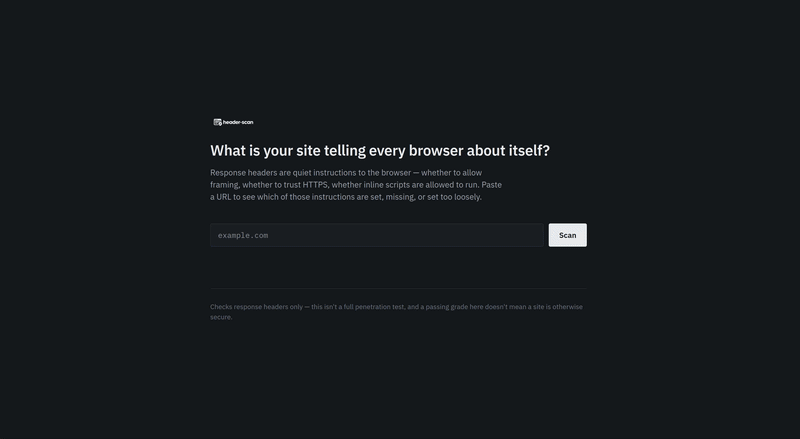

# headerscan

Paste a URL and see which security headers the site sets, which are missing, and what each one means in plain English, with a severity score.

**Live demo:** https://headerscan.netlify.app



## What it checks
- Content-Security-Policy (CSP)
- Strict-Transport-Security (HSTS)
- X-Frame-Options
- [X-Content-Type-Options, Referrer-Policy, Permissions-Policy: keep only the ones your tool checks]

## Features
- Fetches the live response headers of any public URL
- Shows which headers are present, missing or set too loosely
- Plain-English explanation of each header and how to fix it
- Severity scoring for each finding and an overall grade

## Tech stack
JavaScript, CSS, [Netlify Functions, if the fetching runs server-side], deployed on Netlify.

## Run locally
```bash
git clone https://github.com/sra1st/header-scan.git
cd header-scan
[npm install]
[npx netlify dev]
```

## Limitations
Checks response headers only. This is not a full penetration test, and a good grade here does not mean a site is otherwise secure.

## Author
Shafiq · [Upwork profile link]
